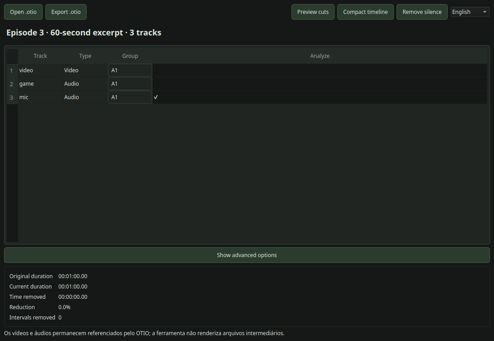
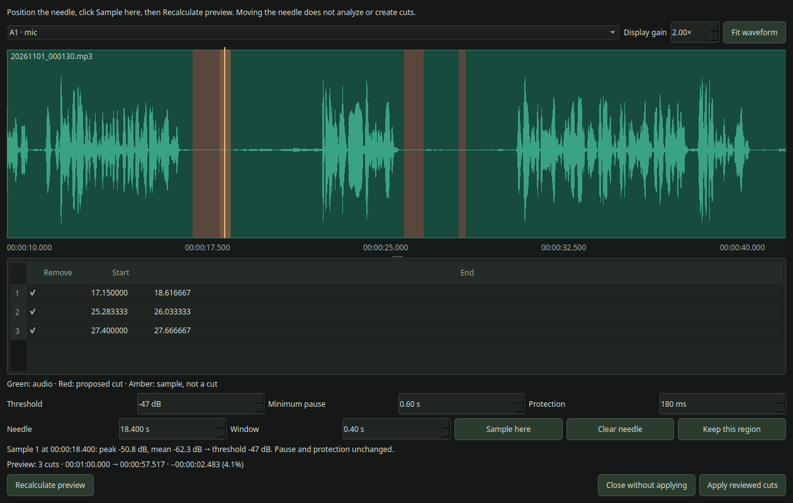
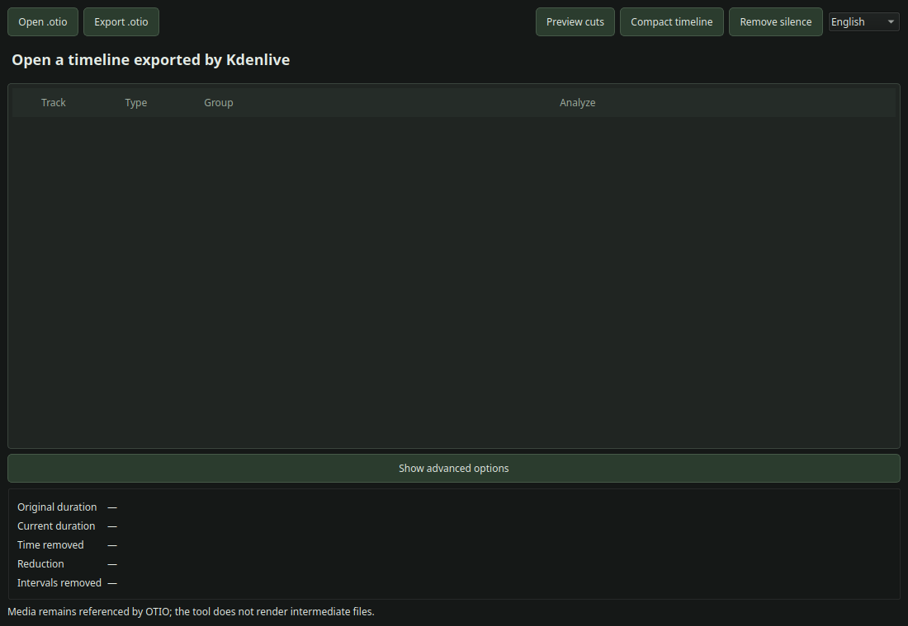
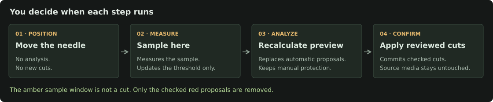
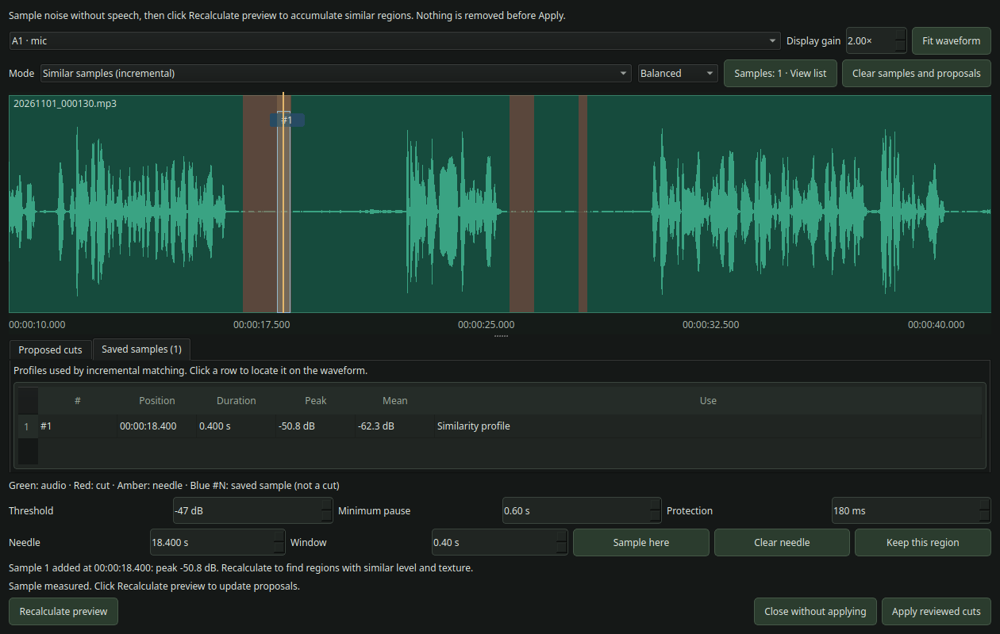
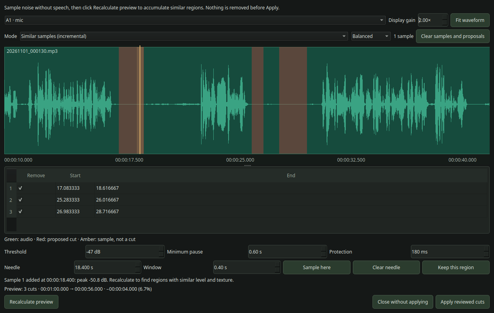
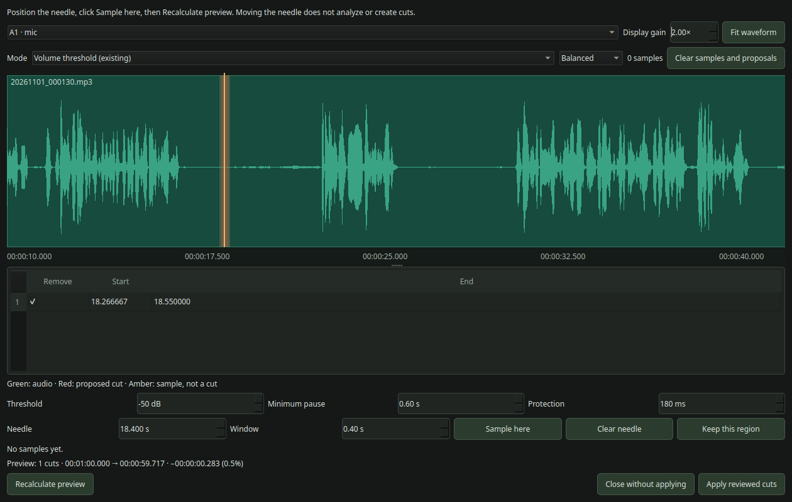
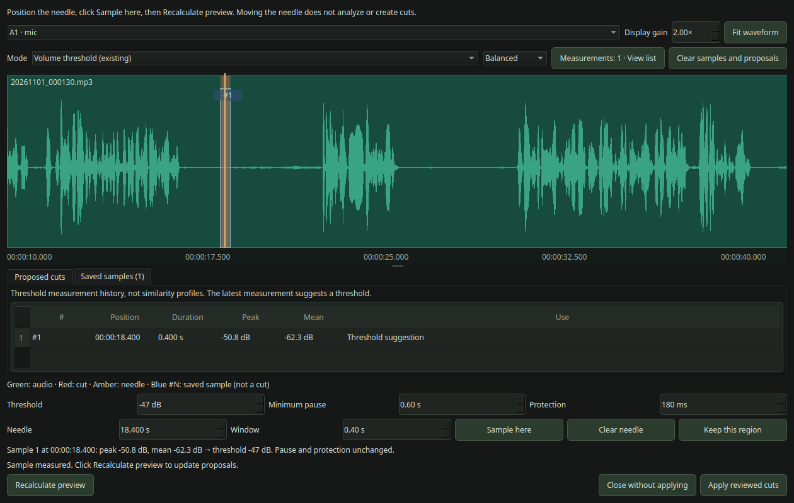
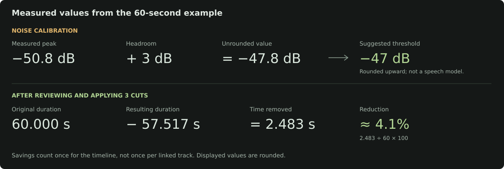
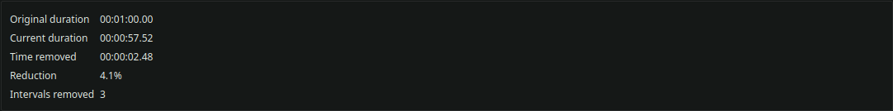

# decut

<p align="center">
  
</p>

**Version 1.0.0** · Python desktop tool for reviewing silence cuts and compacting OpenTimelineIO edits from Kdenlive.

Synchronize your footage in Kdenlive, review linked cuts in decut, then return an editable `.otio` to Kdenlive. No intermediate video rendering or media re-encoding.

## Screenshots

### Tracks and groups



### Waveform review



The screenshots use a real **60-second excerpt** for readability. Waveforms, measurements and reduction values were produced by FFmpeg and the application, not invented UI data.

<details>
<summary>Before importing a timeline</summary>



</details>

## Features

- Linked video, game audio and voice cuts through explicit track groups.
- FFmpeg silence detection using one reference audio track per group.
- Filled, linear waveforms with take boundaries, zoom, pan and display-only gain.
- Synchronized seconds/frame needle positioning and one-frame stepping.
- Local audio audition from the needle or the exact sampling window, with preview-only volume.
- Persistent waveform cache in the user's cache directory, invalidated when source media changes.
- Manual noise sampling: moving the needle never starts calibration or creates a cut.
- Optional incremental noise-profile matching to accumulate similar regions from multiple samples.
- Optional WebRTC VAD speech guard that protects possible voice from automatic cuts.
- Clear no-match feedback when VAD protects all matches in aggressively denoised audio.
- Numbered blue sample markers and a saved-samples table with time, duration and measured levels.
- Separate **Sample here**, **Recalculate preview** and **Apply reviewed cuts** actions.
- Editable cut boundaries, individual checkboxes and **Keep this region** protection.
- Three gap-compaction modes, independent of silence analysis.
- Original/current duration, removed time, reduction percentage and interval counts.
- Suggested export filenames and a remembered export folder.
- Portuguese and English interface, cancellable background work and Linux AppImage packaging.

> Detection is amplitude-based, not speech recognition. Quiet speech can be mistaken for silence. With **Protect speech (VAD)** enabled, possible voice is removed from silence candidates using a lightweight WebRTC VAD pass. It is a safety guard, not a transcript; always review proposed cuts and keep your original timeline.

## Quick start

### From source

Requirements: Python **3.10+**, a working Qt desktop environment and **FFmpeg** in `PATH`. Development has been tested with Python 3.12 on Linux.

```bash
python3 -m venv .venv
.venv/bin/pip install -r requirements.txt
bash run_otio_tool.sh
```

To check the version without opening a window:

```bash
bash run_otio_tool.sh --version
# decut 1.0.0
```

For a custom FFmpeg installation:

```bash
DECUT_FFMPEG=/absolute/path/to/ffmpeg bash run_otio_tool.sh
```

### AppImage

If you have built or obtained `decut.AppImage`:

```bash
chmod +x decut.AppImage
./decut.AppImage
```

The AppImage bundles the Python application and Qt dependencies. FFmpeg is included when present on the build machine; otherwise install it on the target machine. See [build instructions](docs/development.md#appimage-build).

## Kdenlive → decut → Kdenlive

1. Import and synchronize your media in Kdenlive.
2. Export the timeline as **OpenTimelineIO (`.otio`)**.
3. Open it in decut and assign matching video/audio tracks to a group.
4. Mark **Analyze** on **one reference track per group**, usually the microphone. Leave game audio unchecked.
5. Click **Preview cuts** or **Remove silence**. Both open the same nondestructive review window.
6. Inspect the red regions. Optionally sample noise and recalculate, edit boundaries or uncheck cuts.
7. Click **Apply reviewed cuts**. Selected intervals are removed and closed across the group's tracks together.
8. Export the result and import the new `.otio` in Kdenlive. Render your final video there.

Example:

| Track | Group | Analyze |
|---|---|---|
| Gameplay video | A1 | No |
| Game audio | A1 | No |
| Microphone | A1 | Yes |
| Second camera | A2 | No |
| Second reference audio | A2 | Yes |

Groups are independent: cutting `A1` does not change `A2` or unassigned tracks. Put everything that must remain synchronized in the same group.

## Manual sampling and review

Choose **Volume threshold (existing)** to replace proposals when recalculating, or **Similar samples (incremental)** to accumulate approximate acoustic matches. Both modes require explicit actions and share the same review/apply flow.



1. Place the amber needle in a quiet region without speech. Click/drag or enter a position in seconds. **This does not measure or modify cuts.**
2. Choose the sample window and click **Sample here**. Threshold mode updates the setting only; incremental mode stores a noise profile only.
3. Click **Recalculate preview** to generate new proposals. Until then, Apply is disabled when the settings are stale.
4. Uncheck cuts, edit start/end times or choose **Keep this region** at the needle. Protected regions remain unchecked on subsequent recalculations in that review.
5. Click **Apply reviewed cuts** only when satisfied. **Close without applying** discards the review's pending edits.

**Clear needle**, `Esc` or `Delete` hides the needle and amber sample window without changing cuts. The amber area is **not** a deletion. Only checked red intervals are applied.

You can position the needle using **Needle (seconds)** or **Frame**; both fields stay synchronized using **Navigation FPS**. It is detected from the timeline, not the source video's native rate, and can be corrected when necessary. Frames are zero-based; for example, frame 3086 at 60 fps is 51.433333 seconds. Use **−1 frame / +1 frame** or `Ctrl` + left/right with waveform focus for exact stepping.

Use **Listen from here (3 s)** to hear the reference audio from the needle, or **Listen to window** to hear the amber sample window. Playback stops at the end of the current take. **Stop** and **Preview volume** affect audition only; moving the needle, starting analysis or closing the review stops playback. Listening never measures noise or changes cuts.

Loud samples show a warning and require **Use this sample anyway**. A sample overlapping speech can suggest a dangerously high threshold; prefer a window wholly inside the pause.

### What does sampling actually change?

It measures **only the amber window**. Moving the needle never forces removal of that region.

| Mode | What happens after Sample here and Recalculate preview? |
|---|---|
| **Volume threshold (existing)** | Uses the suggested dB threshold to analyze the reference audio. The automatic plan is replaced; cuts can appear, disappear or change. |
| **Similar samples (incremental)** | Stores the sample's level and rough noise texture. Finds approximate matches to any stored profile and merges them into the accumulated plan without duplicate intervals. |

The new mode is **not word recognition or exact sound matching**. It compares short windows by RMS/peak level, zero crossings and a brightness measure. It can still match quiet speech. Use **More precise**, **Balanced** or **Broader** and review the results. Protection, minimum pause and manually unchecked regions still apply.

**Clear samples and proposals** resets that group's accumulated noise references and proposals. Switching back to threshold mode retains the existing workflow; recalculate explicitly after switching. Samples and accumulated proposals are not saved as a separate project.

Use **Samples: N · View list** (or **Measurements: N · View list** in threshold mode) to open **Saved samples**. Each row shows its numbered blue waveform marker, timeline position, window duration, peak/mean level and whether it is a threshold measurement or similarity profile. Click a row to locate it without starting analysis. Threshold measurements are shown separately from incremental profiles, so the counter no longer misleadingly stays at zero after calibrating the threshold.





The OTIO export contains the **remaining clips with checked intervals removed and closed within their groups**. Red/amber overlays are only UI markings and are not exported as gaps, colored footage or rendered effects. Existing unrelated gaps are handled separately by Compact timeline.

### Visual example: measure first, then recalculate

This example uses **Volume threshold (existing)**.

**Needle positioned:** the original proposal is unchanged. No measurement runs just because the line moves.



**Sample here clicked:** the measured peak suggests **−47 dB**, but the existing cut list is still unchanged. Recalculation is a separate action.



**After Recalculate preview:** the review screenshot above shows **3 proposals** and **2.483 seconds** of projected savings. The prior automatic plan was replaced, not added on top.

### How the calculations work



**After applying the reviewed plan**, the statistics panel shows the actual timeline reduction:



Read the [complete user guide](docs/user-guide.md) for settings, controls, statistics, saving behavior and troubleshooting.

## Compact existing gaps

Use **Compact timeline** for holes left after manual editing in Kdenlive. Open **Show advanced options** to select the rule:

| Mode | What defines a removable gap? |
|---|---|
| Video defines gaps | No video clip occupies the interval on any video track. Continuous audio in that interval is also removed. |
| Only gaps empty on every track | No track has a clip there. Continuous audio prevents removal. |
| Selected track defines gaps | The selected reference track is empty there, regardless of content on other tracks. |

Compaction applies the same gap intervals to **every track**, not just a group. It does not detect silence inside clips. See [compaction details and cautions](docs/user-guide.md#gap-compaction).

## Export and saved preferences

- Opening `ep3.otio` suggests **`ep3_exported.otio`**.
- The file dialog remembers the last successful export folder across restarts.
- You still confirm saving and any overwrite in the file dialog.
- Track group and Analyze assignments are stored in the exported OTIO metadata.
- Source media remains externally referenced, not copied into the OTIO.
- Calibration, review checkboxes/protection and the language choice are not a separate autosaved project. Save the applied timeline before closing.

## Development and release notes

```bash
.venv/bin/python -m unittest discover -s tests -v
bash build_appimage.sh
```

- [Development, architecture, tests and packaging](docs/development.md)
- [User guide and known limitations](docs/user-guide.md)
- [1.0.0 release notes](CHANGELOG.md)
- [MIT license](LICENSE)

Rebuild the AppImage after updating the source; an existing binary is not changed automatically.
