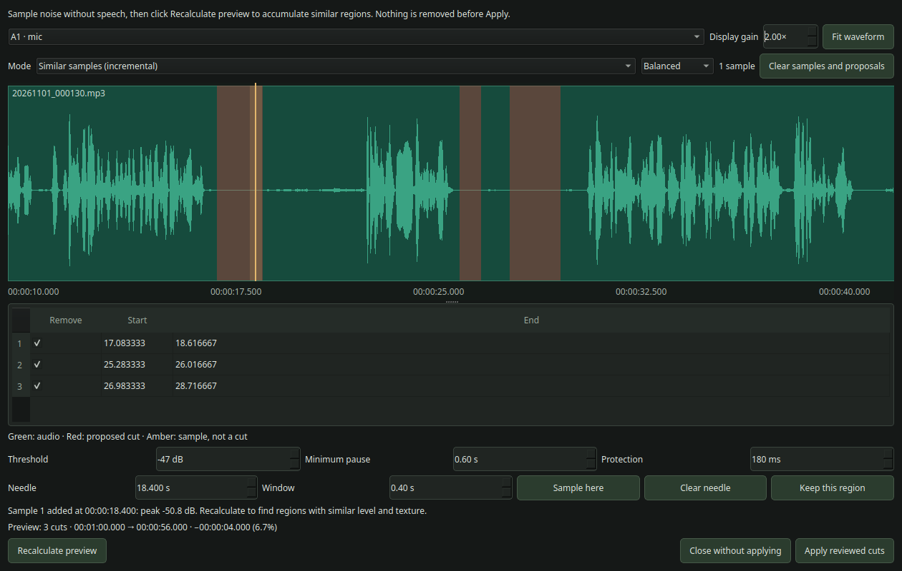
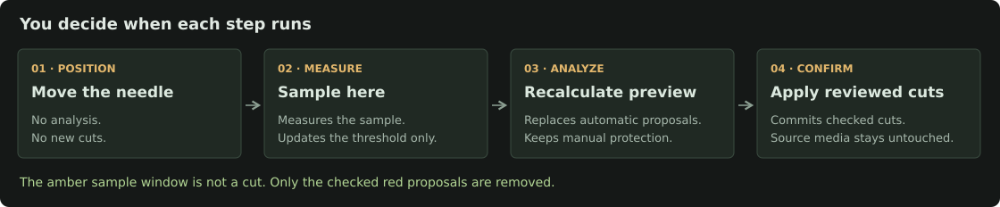

# User guide

Applies to **decut 1.0.0**. The descriptions below use the English interface labels. Switch between English and Portuguese in the main window's language selector.

## What decut changes

decut reads an OpenTimelineIO (`.otio`) timeline, edits clip source ranges and their placement, then writes another OTIO. It does not render an MP4, mix sound, denoise a recording or change source-media quality.

Perform synchronization in Kdenlive first. Keep source files at the locations referenced by the timeline and export to a new OTIO so you can recover the original edit.

## Opening and assigning tracks

Choose **Open .otio** and select your Kdenlive export. The table displays the tracks, their OTIO type, group and Analyze checkbox.

### Groups

Assign the same group, for example `A1`, to a video, its game audio and its microphone. Mark **Analyze** only on the reference you want to control silence removal. All other tracks in that group receive exactly the same timeline intervals without being analyzed.

- Exactly one reference is allowed per analyzed group. Selecting game audio and voice together in the same group is rejected.
- A group with no analyzed reference receives no silence cuts.
- An empty group is not analyzed or linked for silence removal.
- Independent groups can shrink by different amounts. Their synchronization with each other is not preserved unless they share a group.
- Audio can be voice, music, SFX or audio embedded in a video file. The detector does not understand the content.
- A uniquely named `mic`, `microphone`, `microfone`, `voice` or `voz` audio track is preselected when recognized. A lone nonempty audio track is also preselected. Always check the selection.

Track assignments are saved as `decut` metadata on export. Editing the displayed track name is not a supported renaming workflow; rename tracks in Kdenlive.

## Silence detection settings

Open **Show advanced options** in the main window. These settings are also editable in the review.

| Setting | Range | Default | Meaning |
|---|---|---|---|
| Threshold | −80 to 0 dB | −50 dB | Audio below this amplitude can be classified as silence. Moving toward 0 dB is more aggressive. |
| Minimum pause | 0.05 to 30 seconds | 1.0 second | Shorter pauses are not detected. |
| Protection | 0 to 2000 ms | 180 ms | Preserve this amount at both ends of a detected silence. |

**Protect speech (VAD)** is enabled by default in the desktop UI. It adds a lightweight WebRTC voice-activity pass after FFmpeg silence detection. Candidate silence that overlaps possible voice is kept instead of cut. This can leave more pauses on noisy recordings, but is safer for quiet speech. It can be toggled in advanced detection settings and the review window.

For example, a two-second silence with 180 ms protection on each side yields at most 1.64 seconds of removal, before frame alignment. If protection consumes the whole interval, no cut is proposed.

The default is intentionally conservative and can leave pauses containing background noise. There is no universal safe threshold for every microphone or speaker.

The analysis uses FFmpeg `silencedetect` on the first audio stream (`0:a:0`) of each referenced media file. It caches results within the review, intersects them with each clip's source range, maps them into timeline time, preserves protection margins and rounds detected cut boundaries inward to timeline frames.

## Review workflow

**Preview cuts** and **Remove silence** open the same review. Opening it starts preparation of the initial proposals and waveform, but does not edit the current timeline.

1. Select the reference group at the top.
2. Inspect the waveform and red cut regions.
3. Change settings or measure a sample if necessary.
4. Explicitly choose **Recalculate preview** after changing settings.
5. Review the list, disable unwanted cuts or edit boundaries.
6. Choose **Apply reviewed cuts** to commit the selected plan to the current in-memory timeline.
7. Return to the main window and export an OTIO file.

The reviewed plan is applied directly. Applying does not rerun silence detection and substitute a different set of cuts. Cut intervals close within their groups automatically; you do not need a separate compaction pass for those intervals.

Applying again in a new review works on the already-edited in-memory timeline. Reopen the original OTIO if you want to start from the original edit. There is no general undo history.

### Waveform display

- Filled green shapes use a **linear amplitude scale**. Quiet regions stay near the center line.
- Take names and borders show edit boundaries. Peaks are displayed symmetrically around the center as an envelope, not as separate stereo channel lanes.
- Red highlights indicate active removal proposals.
- Amber highlights indicate the sampling window only. They never force a cut.
- **Display gain** ranges from 0.5× to 16×, default 2×. It changes only the drawing, not sample measurements, media volume or detection.
- Long recordings viewed in full can hide short pauses within a single screen pixel. Zoom in to inspect them.

Waveform data is read as small FFmpeg PCM buckets, with a capped number of cached peaks per clip. It is not a full-resolution audio-editing buffer. Short audition is available through the playback controls described below.

### Navigation

| Action | Control |
|---|---|
| Place the needle | Left-click the waveform |
| Move the needle in seconds | Drag with the left button or edit Needle (seconds) |
| Move the needle to a frame | Edit Frame; seconds update automatically |
| Step the needle | Left/right arrow, 100 ms per step |
| Step exactly one frame | −1 frame / +1 frame, or Ctrl + left/right with waveform focus |
| Zoom at the pointer | Mouse wheel |
| Pan horizontally | Drag with the middle mouse button |
| Show the entire reference track | Fit waveform |
| Hide the needle and sample highlight | Clear needle, or Escape/Delete while the waveform has focus |
| Keep a proposed region | Keep this region at the needle, or uncheck it in the list |

Moving the needle, changing display gain or changing the sampling window never starts a detection job.

### Seconds, frames and FPS

The fields are linked, not separate selections. Entering a frame seeks to that frame's starting time (`seconds = frame / FPS`). Entering seconds preserves that time and displays the nearest available frame index; the seconds field also allows subframe positions. Frame 0 is the beginning of the current timeline, not the original media's start or an added global timecode offset. An exact whole-frame end boundary can be selected, but it contains no playable audio.

For example, at 60 fps, frame **3086** is **51.433333… seconds**. The internal needle preserves the frame-derived time rather than converting back from the rounded seconds display. Frame stepping does not accumulate that display-rounding error. Jumps outside the current zoomed view reveal the selected point without changing zoom.

**Navigation FPS** is detected from OTIO timeline time rates, not the external media's native FPS or sample rate. If no usable frame rate is present, it falls back to 30 fps. Verify it matches your Kdenlive project; fractional rates such as 30000/1001 may be entered as approximately 29.97002997. Changing this field updates the frame conversion while keeping the needle's selected time. It does not re-encode media, alter export FPS or rescale the cuts.

### Listening before measuring

- **Listen from here (3 s)** plays up to three seconds from the needle on the selected group's reference audio.
- **Listen to window** plays the actual amber sample window, including its clamping to the take's boundaries.
- **Stop** ends audition. A white dashed playback cursor shows progress while the amber needle stays at the chosen sampling point.
- **Preview volume** changes listening volume only. It is not exported and does not alter detection, source files or display gain.

Audition maps the timeline position back to the take's media source range. It stops at the current take's end instead of playing unused media beyond an edit. It is a short source-audio preview, not a mix of all tracks or a rendered preview with proposed cuts already skipped. Positioning in a gap or at the timeline end cannot start playback.

Moving/clearing the needle, switching reference groups, changing the sample window, starting an analysis job or closing the review stops audition. Listening does not sample noise, recalculate proposals or apply a cut.

Playback uses Qt Multimedia and requires a working audio output device and supported codec/backend. Its codec support is separate from the external FFmpeg executable used for analysis; changing `DECUT_FFMPEG` does not replace Qt's playback backend. Playback errors are shown beside the controls.

## Manual noise calibration

1. Place the needle well inside a region you consider background noise, without speech.
2. Choose a **Window** between 0.1 and 2 seconds (default 0.6 seconds).
3. Ensure the amber region does not overlap a nearby spoken sound. The window is clamped to the current clip and cannot cross an edit boundary.
4. Click **Sample here**. FFmpeg measures the native-rate peak and mean level of that short sample.
5. The proposed threshold is the peak plus 3 dB, rounded upward to an integer and limited to the supported threshold range.
6. Click **Recalculate preview** to analyze with that value. Measurement alone changes the setting, not the cut list.

You can repeat sampling as often as needed. The latest accepted sample replaces that group's threshold; samples are not averaged or accumulated into a speech model. Minimum pause and protection are kept under manual control.

### Loud samples

A suggestion above −25 dB is held for confirmation. **Use this sample anyway** sets the proposed threshold, but still does not recalculate or apply cuts automatically.

A loud reference can classify spoken words or almost the whole recording as silence. Selecting a point immediately before speech is especially risky: even though the point is quiet, the surrounding window can include the next word. Move the needle farther inside the pause or shorten the sample window instead of forcing that measurement.

Moving the needle, changing the window, editing settings or choosing another group dismisses a pending loud-sample confirmation.

### Two analysis modes

**Volume threshold (existing)** uses the sampled peak plus 3 dB as a suggested threshold. **Recalculate preview** rebuilds the proposals, replacing the previous automatic plan. It can produce more or fewer cuts or different boundaries; it does not accumulate every past plan.

**Similar samples (incremental)** learns approximate acoustic noise profiles instead:

1. Select the mode, place the needle and click **Sample here**. This stores a profile for that group without searching yet.
2. Click **Recalculate preview** to find regions resembling any stored profile.
3. Sample another unwanted noise/pause and explicitly search again to extend the plan.
4. Previous proposals are retained and overlapping intervals merged, rather than duplicated. Narrowing similarity or changing minimum pause/protection does not retract accumulated proposals; reset them to start over with stricter rules.
5. Uncheck false positives or use **Keep this region**. Protection survives later searches in the same review.
6. Use **Clear samples and proposals** to reset the selected group's profiles and accumulated proposals. Manual protection is retained; re-enable protected cuts in the list if desired.

Matching compares 100 ms mono windows by RMS/peak level, zero-crossing rate and a first-difference energy measure of brightness. It is not exact waveform matching, transcription, word recognition or VAD. Short, quiet speech can resemble noise; review all matches.

The similarity choices scale permitted feature differences:

| Choice | Tolerance factor |
|---|---|
| More precise | 0.7× |
| Balanced | 1.0× |
| Broader | 1.3× |

Balanced compares RMS within 6 dB, peak within 9 dB, zero-crossing fraction within 0.12 and brightness within 0.35. These are heuristics, not a similarity confidence or a speech-safety score. Minimum pause is evaluated before the protection margin is applied. The threshold spinbox is unused/disabled in this mode.

Switching modes marks the preview stale and requires explicit recalculation. Incremental proposals are kept separately from threshold proposals, so a threshold-mode plan is not automatically copied into the accumulator. Audio profiles and accumulators last only for the current review.

In both modes, no proposed interval, including the sample window itself, is mandatory: uncheck it or use **Keep this region**. A sampled window may not match after minimum-duration/protection rules, and it is not force-added as a cut.

The [README's visual walkthrough](../README.md#visual-example-measure-first-then-recalculate) shows actual screenshots before measurement, after measurement and after recalculation, with a worked example of the duration calculation.

### Finding saved samples

The counter above the waveform is clickable. In threshold mode it reads **Measurements: N · View list**; in incremental mode it reads **Samples: N · View list**. It opens the **Saved samples** tab beside **Proposed cuts**.

The table lists the sample number, timeline position, window duration, peak, mean and use. Numbered blue bands (`#1`, `#2`, etc.) mark the stored windows on the waveform. These are references, not cuts, and they stay visible when you clear the live amber needle.

Clicking a sample row moves the needle and zooms to that reference without measuring or recalculating. Successful measurement opens the samples tab for feedback; recalculation returns to the cut tab for review.

Lists are scoped to the selected group and mode. Threshold measurement history is not a set of incremental similarity profiles; switch to incremental mode and measure there to create profiles. A pending loud sample is recorded only after confirmation. Resetting samples/proposals removes that group's incremental references and markers, not its threshold measurement history.

These records last for the current review and are not saved to the OTIO. No blue/amber/red UI marker is embedded in the exported edit.

## Editing and protecting cuts

The cut table contains **Remove**, **Start** and **End**. Boundary values are seconds in the current timeline, not source-file time or frame numbers.

- Uncheck **Remove** to keep a proposed interval.
- **Keep this region** unchecks proposals containing the needle position. It keeps the entire matching proposal, not just the amber sample window.
- Edit Start/End to adjust a removal. Start must be less than End and both must be within the reference timeline.
- Invalid boundaries disable Apply until corrected.
- Manually protected regions remain unchecked if a recalculated proposal overlaps them. Re-enable a checkbox to remove its protection.
- Protection is kept during the current review only. Closing without applying discards pending review choices.
- Clearing the needle does not clear or create cuts and does not reset protection.

Recalculation uses the current review's unchanged timeline. Merely experimenting with thresholds or taking samples does not progressively delete content.

## Gap compaction

Compaction is separate from amplitude analysis. A silent clip still counts as occupied; a gap is an interval with no clip on the reference track(s).

Choose a mode under **Show advanced options**, then click **Compact timeline** in the main window:

| Mode | Rule | Example with a video gap and continuous game audio |
|---|---|---|
| Video defines gaps | An interval must be empty on all video tracks. With no video tracks, use all tracks instead. | Removes the gap and the corresponding audio interval. |
| Only gaps empty on every track | Every track must be empty at that time. | Keeps the interval because the audio has content. |
| Selected track defines gaps | Use only the selected reference track's occupancy. | Removes the interval if that reference has a gap. |

The `ⓘ` button explains the choices. The reference-track picker matters only for Selected track mode.

**Compaction applies globally across all tracks, regardless of groups, and acts immediately on the in-memory timeline.** It does not use the silence-review window. Export separately afterward.

The detector considers gaps within the chosen reference tracks' duration, including leading or explicit trailing gaps. It does not treat audio continuing beyond a shorter video track as an extra trailing gap. An entirely empty reference produces no compaction. Repeating the same mode after its gaps have been removed should report zero additional gaps; changing the reference/mode may find different gaps.

## Statistics

### Main window

- **Original duration:** duration of the OTIO opened in this session.
- **Current duration:** duration after applied edits.
- **Time removed:** original minus current duration, not the sum of every track's deletions.
- **Reduction:** removed duration divided by original duration.
- **Intervals removed:** count from the most recent operation. For silence removal it is the sum of group interval counts; simultaneous intervals in two groups count twice. It is not a cumulative session total.

OTIO timeline duration is determined by the longest track. If a separate unedited track is longer, removing content from another group may not reduce the overall duration by the same amount. This is not necessarily a failed cut.

### Review window

The summary projects the count, resulting timeline duration, saved time and percentage for the current checked plan. It does not rebuild a full edited timeline after every checkbox change. Stats become stale when settings change; recalculate before applying.

Red and amber are preview overlays only. Applied intervals are removed from the affected clips and closed within the group; the export does not contain the red overlay or a placeholder gap for those removed intervals. Existing gaps unrelated to the chosen cuts may still remain until separately compacted.

## Export and persistence

**Export .otio** suggests `<opened-file-stem>_exported.otio`, using the last successful export folder or the opened file's folder on first use. The suffix `.otio` is added when missing.

The dialog still requires a save confirmation and may ask before overwriting. The tool does not automatically replace the original file.

What is saved:

| Data | Location/lifetime |
|---|---|
| Applied clips, source ranges and gaps | Exported `.otio` |
| Track group and Analyze choices | Exported track `decut` metadata |
| Last successful export folder | Qt `QSettings` for organization/application `decut` |
| Media | Original external files; not copied |
| Threshold samples, caches, pending cuts and protection | Current review/session only |
| Language | Current app session only |

There is no project-library autosave or persisted review workspace. Close without exporting and applied in-memory edits are lost. Export after applying changes.

## Long-running work and cancellation

Analysis and waveform generation can take tens of seconds or longer depending on file size, clip count and the machine. A stage label, elapsed time and clip waveform progress distinguish this from a frozen app.

**Cancel and close** stops the owned FFmpeg process and dismisses the review without applying it. Closing the main window closes the review too, cancelling active work before the worker is destroyed. Final OTIO reconstruction also runs off the GUI thread.

## Troubleshooting and limitations

### No cuts or almost no cuts

Check the reference audio and group, threshold, minimum pause and protection. Background noise can prevent `silencedetect` from seeing a long enough pause. Sample a representative quiet region and review a less conservative threshold instead of assuming every low-volume section is safe to delete.

### Speech is marked for removal

Lower the threshold toward more negative dB, increase protection, uncheck the region or use **Keep this region**. Avoid learning a noise level from a sample that includes speech. This version has no VAD or transcription-based speech protection.

### The sampling region is yellow

Yellow/amber is the measurement window, not a cut. Moving or clearing it does not modify red proposals. Measurement and recalculation require their own buttons.

### An imported timeline looks different in Kdenlive

OTIO is an interchange format, not a complete `.kdenlive` project representation. Flat tracks of ordinary clips and gaps are the intended workflow. Transitions, nested compositions, time remapping and complex effects are not fully supported; reference clips with effects are rejected by the analyzer. Round-trip fidelity for Kdenlive-specific effects, markers, compositing, grouping or producer metadata is not guaranteed. Compare a short test edit before using a complex project.

### Missing media or audio stream

Keep the original paths accessible and check permissions. Relative media paths currently resolve from the process working directory, not necessarily the OTIO folder. Only the first audio stream of a file is analyzed; track metadata choosing another stream is not honored. Files without a usable audio stream cannot serve as references.

### Need to undo an applied operation

Reopen the original OTIO or a previously saved export. Keep separate exports while testing; a general undo stack and recovery autosave are not implemented.

### AppImage fails to start

Run it in a terminal to see the error. See the [packaging troubleshooting guide](development.md#packaging-troubleshooting) for FUSE, Qt platform plugins, missing bundled files and build-system compatibility.
